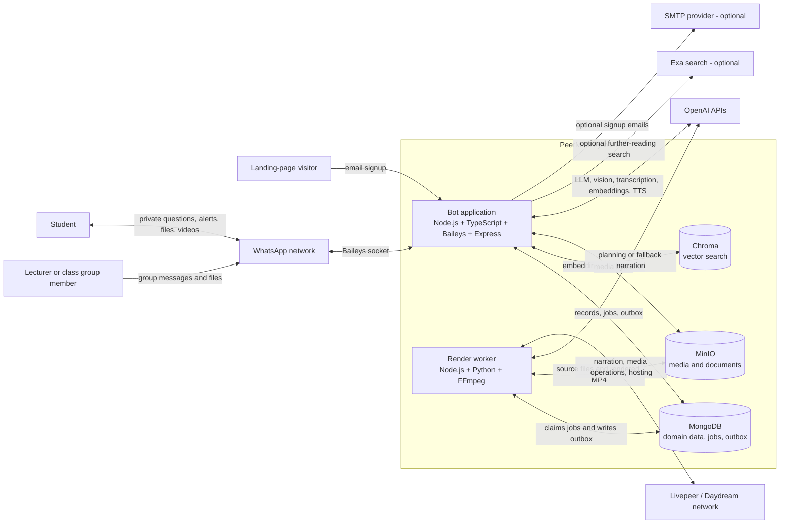
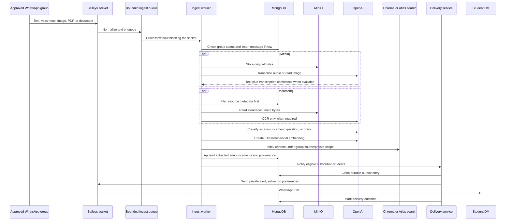
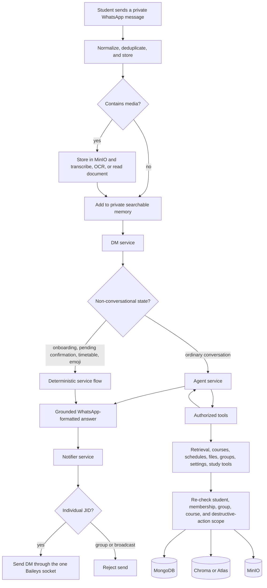
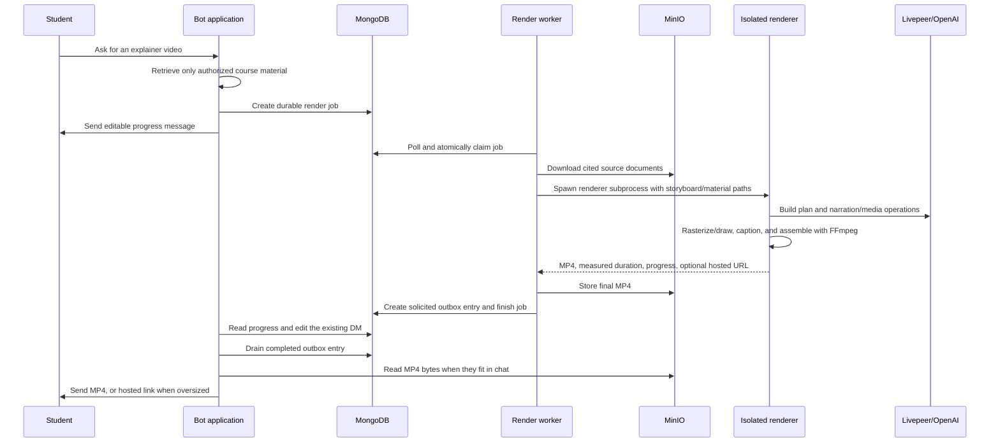
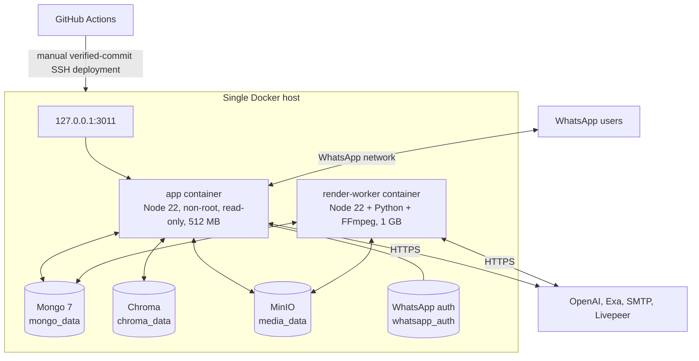

# PeerMate Architecture

PeerMate is a WhatsApp-first student assistant. It silently ingests approved university
group content, turns messages and files into searchable knowledge, and answers each
student privately. The system is a **modular TypeScript application with a separate
render worker**, not a conventional HTTP microservice platform. WhatsApp/Baileys is the
primary interface; Express exposes only signup, health, readiness, and operational
endpoints.

## 1. Project Structure

```text
peermate-full/
├── src/
│   ├── index.ts                 # Bot-process composition root
│   ├── render-main.ts           # Render-worker composition root
│   ├── whatsapp/                # Baileys socket, JID handling, normalization
│   ├── workers/                 # Ingestion queue and durable render-job worker
│   ├── services/                # Product and orchestration logic
│   │   └── agent/               # Tool-using conversational agent
│   ├── repositories/            # All MongoDB access
│   ├── models/                  # Zod-backed domain contracts
│   ├── db/                      # MongoDB, MinIO, and Chroma clients
│   ├── scheduler/               # Digest, reminder, deadline, and outbox tick
│   ├── http/                    # Small Express operational/signup API
│   └── scripts/                 # Migration, evaluation, repair, and smoke tools
├── render/                      # Isolated video planning/rendering package
│   ├── src/                     # Planner, narration, slides, captions, FFmpeg, Livepeer
│   └── python/                  # Fixed whiteboard rendering engine
├── tests/                       # Application unit/integration-style tests
├── landing_page/                # Static landing-page source
├── evals/                       # Retrieval and answer-quality fixtures
├── compose.prod.yml             # Production topology
├── Dockerfile                   # Single-socket bot image
├── Dockerfile.worker            # Media-capable render-worker image
├── .github/workflows/pipeline.yml
└── ops/deploy.sh
```

The code follows a consistent dependency direction:

```text
entry points -> workers/HTTP -> services -> repositories -> databases
                              -> external API clients
```

Services do not query MongoDB collections directly; repositories own persistence.

## 2. High-Level System Diagram

### 2.1 System context and containers



### 2.2 Group knowledge-ingestion flow



Important properties of this path:

- Group messages are discarded before storage unless the group is active/approved.
- `waMessageId` is unique, so reconnect redelivery is stopped before paid AI work.
- Originals are retained even when transcription, OCR, extraction, or indexing fails.
- Announcements are append-only and retain source message, sender, time, authority, and
  supersession information.
- Retrieval is scoped by the student's verified `groupJids` before course filtering.
- Peermate never posts into a group; notifications are private DMs only.

### 2.3 Student question and agent flow



The model chooses tools, but code authorizes every operation. The agent is bounded by
tool-call, retry, repeated-call, and wall-clock limits. Retrieved messages, documents,
transcripts, and web content are treated as untrusted evidence rather than instructions.

### 2.4 Explainer-video flow



The render worker never mounts `auth_state` and never opens a WhatsApp socket. MongoDB
is the job/progress/outbox control plane; MinIO is the byte-transfer plane.

### 2.5 Scheduled and recovery flow

Every 15 minutes in `Africa/Lagos`, the bot process:

1. Updates the current shard heartbeat.
2. Drains pending outbox entries left by crashes or temporary WhatsApp outages.
3. Sends due timetable reminders.
4. During the first quarter of an hour, sends each student's configured digest.
5. At the default digest hour, sends deadline attachments without duplicating the
   deadline text already included in the digest.

At startup it also runs idempotent tenancy backfill, resumes interrupted deletions,
reconciles live WhatsApp groups, drains the outbox, recovers unfinished ingestion, and
backfills older private messages into search.

## 3. Core Components

| Component             | Main code                                                                 | Responsibility                                                                                                                         |
| --------------------- | ------------------------------------------------------------------------- | -------------------------------------------------------------------------------------------------------------------------------------- |
| Bot composition root  | `src/index.ts`                                                            | Connects dependencies, registers socket events, starts scheduler/HTTP, performs recovery, and shuts down gracefully.                   |
| WhatsApp adapter      | `src/whatsapp/`                                                           | Owns the one Baileys socket, auth session, JID normalization, group events, and inbound message callbacks.                             |
| Ingestion worker      | `src/workers/ingest.worker.ts`                                            | Deduplicates, stores media, transcribes/OCRs, branches DM versus group processing, extracts announcements, and indexes knowledge.      |
| DM orchestration      | `src/services/dm.service.ts`                                              | Serializes each student's conversation and handles onboarding, confirmations, timetable paths, and agent invocation.                   |
| Agent and tools       | `src/services/agent/`                                                     | Runs bounded model/tool loops; tools re-resolve identity and authorization before reading or changing state.                           |
| Retrieval/indexing    | `retrieval.service.ts`, `indexing.service.ts`                             | Creates embeddings, writes Chroma/Atlas knowledge, and searches only authorized group/private namespaces.                              |
| Delivery and notifier | `delivery.service.ts`, `notifier.service.ts`                              | Applies consent/timing preferences, persists outgoing work, retries socket sends, and blocks group sends.                              |
| Scheduler             | `src/scheduler/index.ts`                                                  | Drives reminders, digests, deadlines, shard heartbeat, and outbox recovery.                                                            |
| Render orchestration  | `storyboard.service.ts`, `render-progress.service.ts`, `render.worker.ts` | Creates jobs, reports measured progress, materializes files, invokes the renderer, and hands completed video back through the outbox.  |
| Renderer package      | `render/`                                                                 | Plans grounded lessons, renders slides/whiteboards, creates narration/captions, invokes Livepeer operations, and assembles MP4 output. |
| HTTP server           | `src/http/server.ts`                                                      | Exposes signup, liveness/readiness, metrics, queue depth, and group inspection routes.                                                 |
| Repositories/models   | `src/repositories/`, `src/models/`                                        | Centralize MongoDB access and runtime-validated domain contracts.                                                                      |

## 4. Data Stores

### MongoDB

MongoDB is the system of record. Major collection groups are:

- **Identity and tenancy:** `users`, `groups`, `shards`, `courses`.
- **Inbound knowledge:** `messages`, `extractions`, `resources`, `knowledge`.
- **Student state:** `schedules`, `assignments`, `assignment_states`, `quiz_attempts`,
  `conversations`, `memory_collections`.
- **Durability and workflow:** `outbox`, `render_jobs`, `deletion_jobs`,
  `pending_decisions`, `notifications`.
- **Public signup:** `landing_signups`.

The database name is versioned using `DATA_VERSION`. Operational indexes are created
idempotently at boot; Atlas vector/search indexes are created separately by the Atlas
migration script.

### MinIO

MinIO stores original voice notes, images, documents, generated audio/video, and final
MP4 files. MongoDB stores their keys and provenance; application and render containers
exchange bytes through MinIO rather than a shared filesystem.

### Chroma and MongoDB Atlas Search

Chroma is the production Compose search backend. `SEARCH_BACKEND` supports a staged
migration:

- `chroma`: read/write Chroma.
- `dual`: read Chroma and mirror writes into MongoDB Atlas knowledge records.
- `atlas`: read/write Atlas-backed knowledge and allow Chroma retirement.

Embeddings use OpenAI `text-embedding-3-small` at 512 dimensions. Each indexed record
retains group/private ownership and source provenance.

### WhatsApp auth volume

`whatsapp_auth:/app/auth_state` is not ordinary cache data. It is the live linked-device
credential and must be mounted by exactly one bot process. It is never mounted into the
render worker or baked into an image.

## 5. External Integrations / APIs

| Integration                     | Status                                 | Use                                                                                                |
| ------------------------------- | -------------------------------------- | -------------------------------------------------------------------------------------------------- |
| WhatsApp via Baileys            | Active, required                       | Inbound group/DM events and every outbound student DM.                                             |
| OpenAI                          | Active, required for AI features       | Extraction, agent reasoning, embeddings, transcription, image reading, planning, and optional TTS. |
| Livepeer/Daydream agent network | Active when video rendering is enabled | Narration, media capabilities, upload/hosting, and render-related network operations.              |
| Exa                             | Optional                               | Clearly labelled further-reading discovery and downloadable course material.                       |
| SMTP                            | Optional                               | Admin notification and student welcome email after landing-page signup.                            |
| LangSmith                       | Optional                               | OpenAI tracing when explicitly enabled.                                                            |
| Meta WhatsApp Cloud API         | Implemented but inactive               | Future split-direction send path; current runtime sends through Baileys.                           |

## 6. Deployment & Infrastructure



Production is defined by `compose.prod.yml`:

- The app is published only on loopback port `3011`; its container port is `3000`.
- MongoDB, Chroma, and MinIO are internal-only Compose services with persistent volumes.
- App readiness requires MongoDB, MinIO, and the WhatsApp socket.
- The app runs as the `node` user with a read-only root filesystem and a temporary
  `/tmp` mount.
- Both application processes use `restart: unless-stopped` and bounded JSON logs.
- Capacity scales through additional bot-number **shards**, each with its own socket
  and auth volume—not replicas of one shard.

The GitHub Actions pipeline validates the app, renderer, Compose file, and both images.
Production deployment is manual and deploys only the exact verified `main` commit. The
server script preserves named volumes and waits up to three minutes for `/ready`.

## 7. Security Considerations

Implemented controls:

- **Tenant boundary:** shared reads require `chatJid` membership in the student's
  verified current or retained-history group scope; course code alone never grants access.
- **Private-memory boundary:** DM-derived knowledge is tagged with `ownerPhone` and is
  not exposed through group retrieval.
- **Authorization in code:** agent tools re-resolve the user/group and re-check live
  membership for sensitive operations.
- **Outbound boundary:** `NotifierService` rejects group and broadcast JIDs; all
  product communication is private.
- **Consent boundary:** proactive delivery respects pauses, quiet hours, digest state,
  muted courses, urgency level, and group preferences.
- **Prompt-injection boundary:** retrieved content is evidence; tools—not prompts—decide
  whether an operation is authorized.
- **Credential isolation:** `.env` and `auth_state` are excluded from images and Git;
  the render worker has no WhatsApp credential.
- **Runtime hardening:** the bot image uses a digest-pinned Node image, non-root user,
  read-only filesystem, memory limit, and loopback-only host binding.
- **Validation:** environment and domain inputs use Zod; signup input is size-limited
  and rate-limited in memory.
- **Durability:** unique keys prevent duplicate ingestion/render claims; the outbox
  gives outbound delivery at-least-once semantics.

Operational cautions:

- `/admin/metrics`, `/admin/queue`, and `/admin/groups` have no application-layer
  authentication. They are safe only while port 3011 remains loopback-only or an
  authenticated reverse proxy protects them.
- The signup rate limiter is in-memory and per process; it is not a distributed abuse
  control.
- Student content is sent to configured AI/search/render providers when those features
  are used. Provider retention and data-processing terms are deployment concerns.
- A hosted oversized video URL may be public. Inline WhatsApp delivery is the preferred
  path for private course material.
- Outbox delivery is intentionally at-least-once: a crash after WhatsApp accepts a
  message but before MongoDB is updated can produce a rare duplicate.

## 8. Development & Testing Environment

Requirements:

- Node.js 20+; production and CI use Node `22.22.0`.
- Docker Compose for MongoDB, MinIO, and Chroma.
- Renderer: FFmpeg/FFprobe, Python 3, Pillow, and the `render/` Node package.

Primary checks:

```bash
npm ci
npm run verify
npm --prefix render ci
npm run verify:render
npm run verify:compose
```

`npm run dev:local` uses `.env.local`, keeping development data and WhatsApp auth
separate from production. Vitest covers services and flows; Node's test runner covers
the isolated renderer. Evaluation scripts measure retrieval/answer quality and treat
cross-group leakage and followed prompt injections as correctness failures.

## 9. Future Considerations / Roadmap

Evidence-backed next steps visible in the repository:

1. Complete the measured Chroma-to-Atlas migration and remove Chroma only after dual
   comparison succeeds.
2. Add application-layer authentication for operational `/admin/*` routes before any
   non-loopback exposure.
3. Add render caching and spend/rate controls before broad video rollout.
4. Decide whether to activate the Meta Cloud API split-direction design; it is present
   in code but not part of the current runtime.
5. Replace the in-memory public-signup limiter if the HTTP surface scales beyond one
   app process.
6. Add centralized operational monitoring/alerting; current observability is Pino logs,
   `/admin/metrics`, readiness, and optional LangSmith traces.
7. Reconcile the standalone `render/README.md` wording with the now-wired MongoDB/MinIO
   worker delivery path.

## 10. Project Identification

**Project Name:** PeerMate  
**Repository URL:** `git@github.com:dayosalam/peermate.git`  
**Primary Contact/Team:** [TODO: confirm named owner or team]  
**Date of Last Update:** 2026-10-11

| Field                            | Value                                                                            |
| -------------------------------- | -------------------------------------------------------------------------------- |
| Project                          | PeerMate                                                                         |
| Repository                       | `git@github.com:dayosalam/peermate.git`                                          |
| Current package version          | `0.2.2`                                                                          |
| Runtime                          | Node.js, TypeScript, ESM                                                         |
| Primary interface                | WhatsApp via Baileys                                                             |
| Production topology              | Docker Compose on one host                                                       |
| Deployment checkout              | `/home/dayo/peermate` (pipeline default; confirm before changing infrastructure) |
| Documentation updated            | 2026-10-11                                                                       |
| Primary product/operations owner | [TODO: confirm named owner or team]                                              |

## 11. Glossary / Acronyms

- **Baileys:** Unofficial WhatsApp Web client library used for the persistent socket.
- **Chat JID:** WhatsApp address identifying a user or group chat.
- **LID:** WhatsApp linked identity identifier that may differ from a phone-number JID.
- **Shard:** One bot number, one Baileys socket, one auth directory, and its assigned users/groups.
- **Tenancy boundary:** The verified group/private scope that limits what a student can retrieve.
- **Outbox:** MongoDB-backed record of outbound work owed, used for retry and deduplication.
- **Render job:** Durable request for the independent worker to create one explainer video.
- **RAG:** Retrieval-augmented generation; answers are grounded in authorized stored material.
- **Provenance:** Source message, sender, time, filename, and page attached to stored knowledge.
- **MinIO:** S3-compatible object store used for source and generated media.
- **Chroma:** Vector database used by the current production search path.
- **Atlas:** MongoDB Atlas vector and text search, available as a staged replacement for Chroma.
